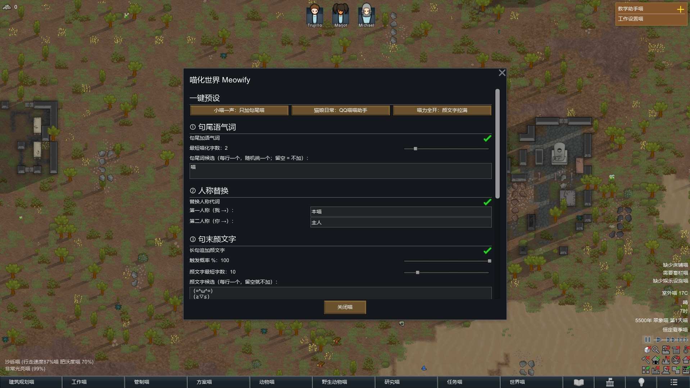

# Meowify（喵化世界）

RimWorld **1.7** 的「全员喵化」模组：不改动任何原始翻译文件，运行时把全部文本换成「QQ喵喵助手」那种猫娘腔——句尾带「喵」、人称替换、长句再加一个猫咪颜文字。需要 Harmony。

效果示例：

- 主菜单 `新建殖民地` → `新建殖民地喵`
- 物品信息 `高草（已生长60%）` → `高草喵（已生长60%喵）`
- `你的殖民者受到了伤害，需要治疗。` → `主人的殖民者受到了伤害，需要治疗喵。（｡･ω･｡）`
- `我的殖民地` → `本喵的殖民地喵`
- 事件/名字/描述由语法规则生成，同样在输出处喵化

## 目录

    About\             模组元数据（About.xml）
    1.7\Assemblies\    1.7（net10.0）编译产物 Meowify.dll（Harmony 由 Harmony 模组提供）
    Source\Meowify\    C# 工程（测试版才有，发布包不含）
    LoadFolders.xml
    tools\             打包脚本

## 截图

| ① 句尾喵 | ② 人称替换 |
|---|---|
|  |  |

实机效果：

| 主菜单 | 殖民地界面 | 社交日志 | 设置界面 |
|---|---|---|---|
|  |  |  |  |

全部图在 `docs/screenshots/`（1920×1080 主视觉与特性图 + 1920×1080 实机截图），可直接用于工坊页面。

## 安装

- 需要 **Harmony**（brrainz.harmony 的 1.7 版本，Harmony 3）
- 发布包解压后整个文件夹放进 `Mods/Meowify/`
- 游戏内模组列表勾选，重启

## 功能与设置

游戏内 **选项 → Mod 设置 → 喵化世界 Meowify**：

最上面是一键预设（小喵一声 / 猫娘日常 / 喵力全开），下面按区块细调，底部有实时预览与高级选项：

| 设置 | 默认 | 说明 |
|---|---|---|
| 一键预设 | 猫娘日常 | 小喵一声 = 只加句尾喵；猫娘日常 = QQ 喵喵助手风格；喵力全开 = 句尾词更多、颜文字更密 |
| 句尾加语气词 | 开 | 按中英文标点断句，在句末标点前插入句尾词；没有标点时补在行尾 |
| 最短喵化字数 | 2 | 少于这个可见字数的文本不加句尾词，避免按钮、图标说明被撑破 |
| 加喵概率 % | 100 | 100 = 每一句都加（默认）；调低则只给一部分句子加喵，适合嫌太密的玩家。按原文哈希决定，同一句结果固定 |
| 句尾词候选 | `喵` | 每行一个，随机挑一个；留空 = 不加句尾词（全文原样） |
| 替换人称代词 | 开 | 默认 `我`→`本喵`、`你`→`主人`（`我们`/`你们` 一并变复数），标签和占位符内不替换 |
| 第一人称 / 第二人称 | `本喵` / `主人` | 可以改成任意词，例如「奴家」「大人」；留空表示不替换 |
| 长句追加颜文字 | 开 | 可见字数达到阈值、且含句读的文本，末尾追加一个猫咪颜文字 |
| 触发概率 % | 100 | 100 = 每句都加，0 = 不加；按原文哈希决定，同一句结果固定 |
| 颜文字最短字数 | 10 | 全文可见字符数达到这个长度才追加，避免把信息卡撑破 |
| 颜文字候选 | 5 个全角颜文字 | 每行一个，可自定义 / 清空 |
| 额外保护词 | 空 | 含「我 / 你」但不是人称代词的词，替换前整体跳过；内置 迷你 / 自我 / 忘我 / 无我 / 敌我 / 你我 / 你死我活 / 你争我夺 |
| 排除片段 | 空 | 每行一个片段；文本里出现任一片段就整段原样返回（不喵化、不换人称），给个别模组的特殊文本留后门 |

细节：

- 设置改完立即生效并清缓存；关闭设置窗口时自动保存
- 「预览」区用当前设置实时喵化三句示例，不用进游戏试
- 颜文字按原文 FNV-1a 哈希确定性选取：同一句话永远同一个颜文字，不会每帧闪烁
- 句末连续重复的句尾词会自动折叠（`几句喵喵。` → `几句喵。`），句中正常的「喵喵叫」不受影响
- 幂等：已经是喵化结果的文本不会被二次处理

## 原理

全部在运行时完成，四个 Harmony 补丁（`Source\Meowify\HarmonyPatches.cs`）：

| 补丁 | 目标 | 作用 |
|---|---|---|
| postfix | `Verse.LoadedLanguage.TryGetTextFromKey` | 界面 Keyed 文本（按钮、提示、标签） |
| prefix | `Verse.DefInjectionPackage.InjectIntoDefs` | DefInjected 注入（物品/特性/研究/事件等 def 字段），跳过 RulePackDef 与占位符 |
| postfix | `Verse.Grammar.GrammarResolver.Resolve` | 语法规则生成的句子（事件日志、名称、描述），避免把规则词块拆散 |
| postfix | `Verse.LoadedLanguage.InjectIntoData_AfterImpliedDefs` | 全部 def 注入完成后扫尾（label/description/背景故事），覆盖未被翻译的 def |

为什么不在 `PlayDataLoader.DoPlayLoad` 上收尾：Mod 构造函数在 DoPlayLoad 帧内部执行，Harmony 不会回溯已进入的帧；`InjectIntoData_AfterImpliedDefs` 是 mod 构造之后才进入的帧，能可靠挂上。

## 喵化规则（`Meowifier.cs`）

- 逐行处理（`\n` 分段），多行文本每行都喵
- 中文句末标点 `。！？…` 之前插入「喵」；没有句末标点就在行尾补（避开行尾闭合标签、右引号/括号）
- 人称替换只作用在可见文本段：`<color=…>` 等标签、`{0}`/`{PROJECT_label}` 占位符原样保留
- 句尾词从候选里随机挑（按原文字符串的 FNV-1a 哈希取模），同一句稳定不变；文本已带任一候选词即视为已处理
- 人称替换前先用私有区字符（U+E000/U+E001）把保护词整体遮住，替换完再还原，避免「迷你」「自我」「敌我」被拆坏
- 颜文字只加给「足够长 + 含句读」的文本，按原文哈希决定是否触发、选哪一个，插在行尾空白之前
- 句尾词是否插入、颜文字是否触发都支持按原文哈希的概率控制（默认 100% 全中）
- 句末/行尾若已连续出现同一个句尾词，会折叠成一个（句中不动）
- 文本命中「排除片段」时整段原样返回，连人称都不换
- 跳过：纯数字/纯空白/纯标点、单字符行
- 幂等：已经以「喵」结尾、或已经带颜文字结尾的文本不重复处理；相同字符串缓存结果（上限 5 万条）

## 构建

    dotnet build Source\Meowify\Meowify.csproj -c Release

产物自动复制到 `1.7\Assemblies\Meowify.dll`。

参考程序集：Krafs.Rimworld.Ref 1.7.4985-unstable + Lib.Harmony 3.0.0-rc.3（`ExcludeAssets="runtime"`，运行时不带 0Harmony）。

## 测试建议

- 主菜单、选项、Mod 列表（Keyed 文本）
- 物品/地块/植物信息卡（DefInjected）
- 事件日志与小人名字（GrammarResolver）
- 殖民者背景故事（BackstoryDef 扫尾）

## 版本号与发版

- 日常改动（修 bug、调文本、小重构）**不升版本号**，只提交测试版仓库；版本号保持当前版本（1.2.0）不动，也不重新打包。
- 只有三种情况才升版本，且升之前先跟 Redbean 确认：
  1. 功能阶段完成、要交付或上传工坊；
  2. Redbean 明确说「发版」；
  3. 有不兼容改动（存档 / 配置 / 接口），必须升并说明影响。
- 升版本动作固定：三处同步 → 打包 → 打 tag
  1. `About\About.xml` 的 `<modVersion>`
  2. `Source\Meowify\MeowifyMod.cs` 的 `const string Version`
  3. `Source\Meowify\Meowify.csproj` 的 `<Version>`
  4. `powershell -NoProfile -ExecutionPolicy Bypass -File tools\make-release.ps1`，产出到 `release\Meowify\`：`Meowify-<版本>\`（可直接放进 `Mods\`）与同名 zip
  5. `git tag v<版本>` 并推送
- 号段语义：`1.0.x` 修 bug / 文本微调；`1.x.0` 新功能；`2.0.0` 不兼容或大改。

## 发布物料

- 工坊发布文案：`docs/workshop.md`（v1.2.0 可直接复制的标题 / 摘要 / BBCode 正文 / 标签 / 截图顺序 / 发布清单）
- 预览图：`About/Preview.png`（1280×720 插画封面，工坊首图；`docs/screenshots/00-poster.jpg` 是它的 1920×1080 版本）
- 截图：`docs/screenshots/`（00 主视觉 + 06/07/08 特性图 + 09 实机效果 + 01–05 真机截图）
- 上传流程：按「版本号与发版」三处同步 → `powershell -NoProfile -ExecutionPolicy Bypass -File tools\make-release.ps1` → 上传 zip → 工坊生成 PublishedFileId 后写进 `About/PublishedFileId.txt`（已被 .gitignore 忽略）

## 参考 / 相关工作

- [qq790795623-sudo/qq-meow-assistant](https://github.com/qq790795623-sudo/qq-meow-assistant)（QQ喵喵助手）：本模组的风格来源——`我`→`本喵`、`你`→`主人` 人称替换、按标点断句句尾加`喵`、消息末尾随机猫咪颜文字（可自定义）、编辑不重复处理。它是 Android 无障碍应用，这里只借它的规则与默认词表，实现完全重写为 Harmony 运行时补丁。
- [csh1668/AutoTranslation](https://github.com/csh1668/AutoTranslation)：运行时机器翻译未翻译文本。它同样把注入点放在 `LoadedLanguage.InjectIntoData_BeforeImpliedDefs` / `InjectIntoData_AfterImpliedDefs`（与本模组的时机判断一致），区别是它把译文写回 keyed / DefInjected 字典；本模组在输出处做变换，不改游戏数据。
- [RimWorld-zh/RimTrans](https://github.com/RimWorld-zh/RimTrans)：成熟的离线翻译工具（导出 / 合并 / 校验），如果以后想把喵化做成静态语言包，可以用它批处理。
- [sgoudham/uwuifyy](https://github.com/sgoudham/uwuifyy)：通用 uwu 文本变形实现，标点与大小写处理可参考。
- 官方机制：Dev 模式「生成翻译报告」+ 未翻译文本列表，可用来核对喵化覆盖率。

## 许可

- 作者：Redbean
- 需要 RimWorld 1.7 与 Harmony（brrainz.harmony）
